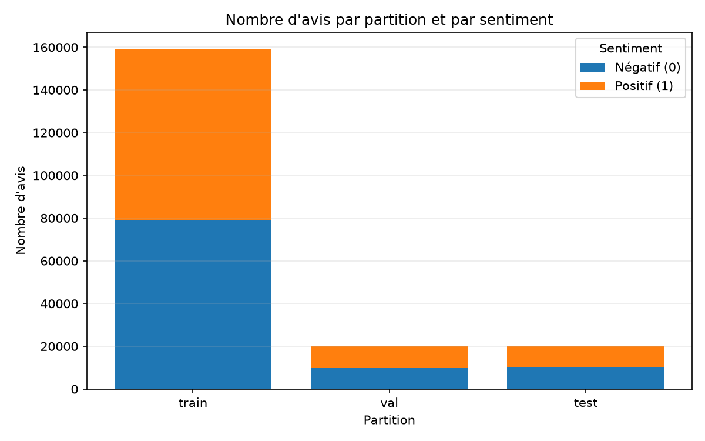
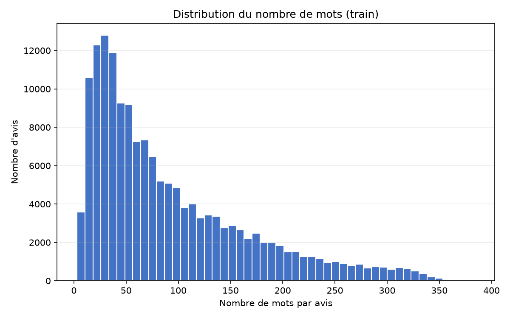
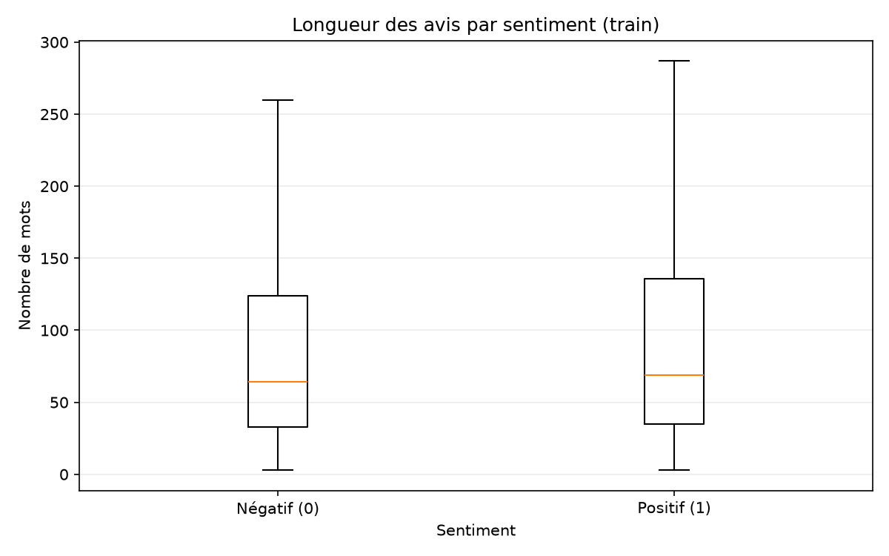

# Rapport de phase 1 — Analyse de sentiments

**Équipe :** Malek Chermiti et Malek Toumi

**Projet :** préparation de critiques de films en français pour une classification de sentiment.

## Structure du projet

```text
.
├── data/
│   ├── raw/                     # Partitions chargées avant nettoyage
│   └── processed/               # Partitions nettoyées
├── models/                      # Vectoriseur TF-IDF sauvegardé
├── outputs/
│   └── figures/                 # Graphiques exploratoires
├── reports/
│   └── rapport_phase1.md        # Présent rapport
├── src/
│   └── allocine_sentiment/      # Modules de traitement des données
├── preparation.py              # Lanceur du pipeline
└── requirements.txt             # Dépendances Python
```

## 1. Compréhension métier

Les avis de films sont des textes non structurés dont l’analyse manuelle devient difficile à grande échelle. L’apprentissage automatique peut aider à classer leur sentiment et à résumer les tendances.

**Objectif métier** : résumer automatiquement l’opinion du public sur un film, à grande échelle.


**Plan :** cadrer le besoin, collecter les données, explorer leur qualité, les préparer.

## 2. Collecte des données

Le corpus **Allociné** (`tblard/allocine`) est chargé depuis Hugging Face avec la bibliothèque Python `datasets`. Le pipeline récupère les partitions `train`, `validation` et `test` — cette dernière est renommée `val` — et conserve le texte (`review`, ou `text` renommé) ainsi que le label. Les labels sont `0` (négatif) et `1` (positif).

Les partitions originales sont sauvegardées dans `data/raw/`. La collecte nécessite une connexion Internet. La provenance et les conditions de réutilisation sont à vérifier sur la [fiche du jeu de données](https://huggingface.co/datasets/tblard/allocine).

## 3. Compréhension des données

Le contrôle examine les types, les labels, la longueur des avis, les doublons et les valeurs manquantes. Les graphiques des données préparées permettent d’observer la répartition des classes et la longueur des critiques d’entraînement.

### Répartition des labels



**Description :** effectifs des avis positifs et négatifs dans les partitions `train`, `val` et `test`.

**Remarque :** ce graphique permet de comparer la répartition des classes entre partitions et de repérer un éventuel déséquilibre. 

### Longueur des critiques d’entraînement



**Description :** distribution du nombre de mots par critique dans la partition d’entraînement.

**Remarque :** cette distribution aide à repérer les avis particulièrement courts ou longs, qui peuvent nécessiter une attention lors de la modélisation.



**Description :** comparaison des longueurs d’avis entre les sentiments négatif et positif dans `train`.

**Remarque :** le graphique aide à voir si la longueur varie selon le sentiment ; une différence éventuelle ne signifie pas que la longueur cause le sentiment.


## 4. Préparation des données

- **Nettoyage :** suppression des lignes sans texte ou label, des doublons exacts et des avis de moins de trois mots.
- **Transformation :** création d’une colonne `clean` en minuscules, suppression des URL et balises HTML, normalisation de la ponctuation et des espaces. Les apostrophes, négations et mots-outils sont conservés.
- **Intégration :** harmonisation du nom des colonnes et des partitions dans le même schéma (`review`, `label`), sans fusion avec une source externe.
- **Enrichissement :** ajout du texte nettoyé, puis vectorisation TF-IDF avec unigrammes et bigrammes (au plus 50 000 termes). Le vocabulaire est ajusté uniquement sur `train`, puis appliqué à `val` et `test` afin d’éviter la fuite d’information.

Les fichiers préparés sont écrits dans `data/processed/`. Le vectoriseur est sauvegardé dans `models/` et les graphiques dans `outputs/figures/`.
